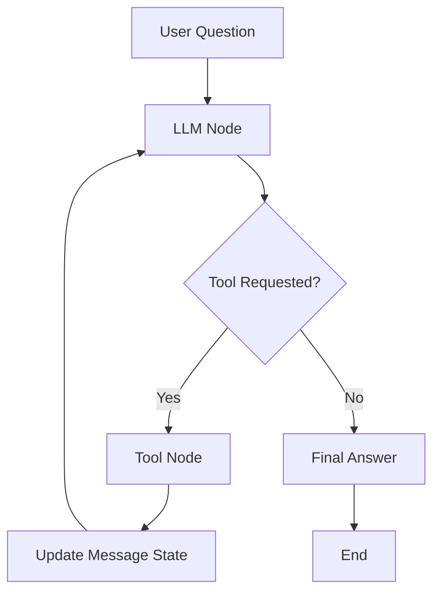

# LangGraph Components and State

## Overview
LangGraph represents a workflow as a graph of connected nodes. It manages the state as the workflow moves between steps.

## State
The `AgentState` class defines the application's state:

- `messages`: Stores system, user, assistant, and tool messages.
- `add_messages`: Adds new messages to the existing message history instead of replacing it.

## Nodes
- **LLM node (`call_llm`):** Sends the current messages to the model and returns its response.
- **Tool node (`ToolNode`):** Executes tools requested by the model.

## Edges
- **Conditional edges:** `tools_condition` checks whether the model requested a tool.
- **Tool-to-LLM edge:** Returns the tool results to the LLM for the next decision.
- **Entry point:** The graph starts at the LLM node.
- **End:** The workflow finishes when the model no longer requests a tool.

## Tools
- `average_dog_weight`: Returns mock average weights for supported dog breeds.
- `calculate`: Performs basic arithmetic using a restricted evaluator.

## Workflow
1. Receive the user's question.
2. Add the question and system instructions to the initial state.
3. The LLM decides whether a tool is needed.
4. If requested, the tool node executes the tool.
5. Tool results are added to the message state.
6. The graph returns to the LLM node.
7. The process repeats until the LLM provides a final answer.

## Main Components Used
- `StateGraph`
- `AgentState`
- `add_messages`
- `ToolNode`
- `tools_condition`
- `builder.add_node()`
- `builder.add_edge()`
- `builder.add_conditional_edges()`
- `builder.compile()`
- `graph.invoke()`

## Test Results
- Toy Poodle weight: Passed, returned 7 pounds.
- Combined Border Collie and Scottish Terrier weight: Passed, returned 57 pounds.

## Connection to the Previous Task
The previous task implemented the ReAct loop manually in Python. This task uses LangGraph to manage the state, node transitions, tool execution, and looping.

## Workflow Diagram

